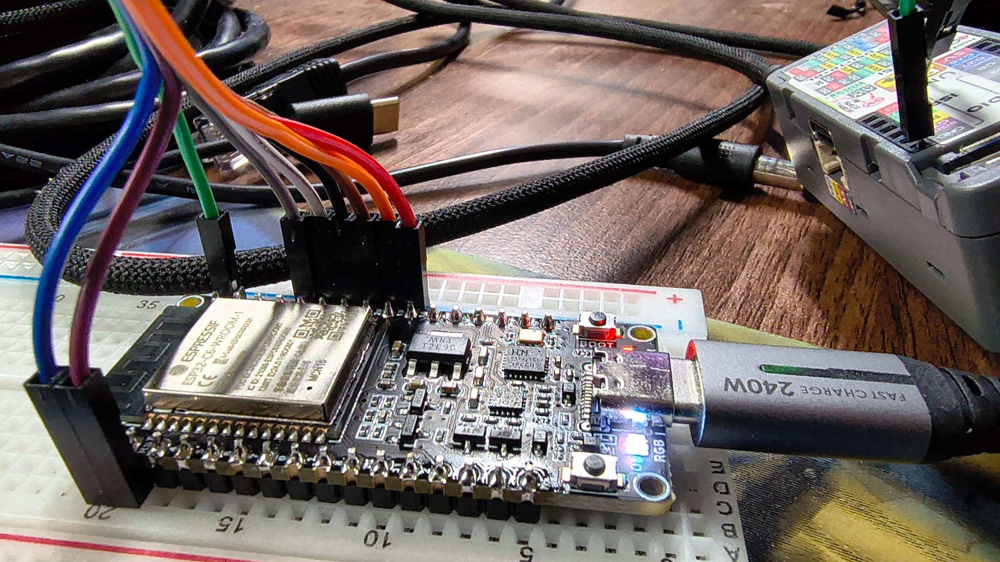
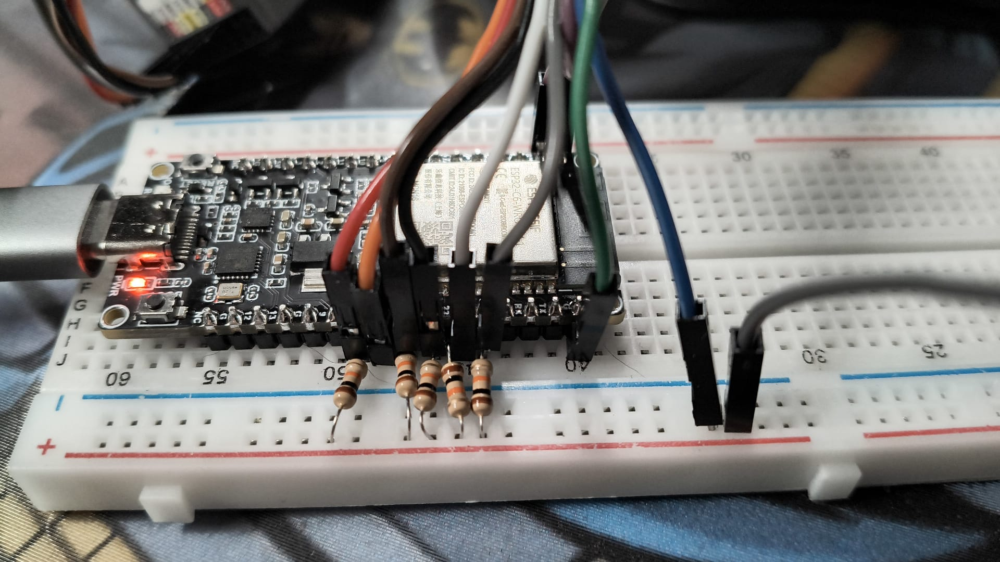

How to run a local DHCP server and MQTT broker for development and testing
without needing external infrastructure.

---

## DHCP Server (dnsmasq, for direct Ethernet connection to device)

When you test the ESP32-P4 or S3 over a direct Ethernet connection (for
example a USB-Ethernet adapter on your dev machine), that interface needs a
DHCP server. Without one, the P4 falls back to an AutoIP `169.254.x.x` address
and can't reach the broker on `192.168.2.1`. Use the `dockurr/dnsmasq` image,
run with Docker Compose from `~/docker/dnsmasq`.

The services are **started on demand** (`restart: no`), not at boot. Start
them at the beginning of a bench session.

### 1. Assign a static IP to your Ethernet interface

The DHCP server needs the host interface to already have an IP in the subnet.
The address is added by hand and is lost when the adapter is unplugged, so
re-add it after a replug:

```bash
# Find your USB-Ethernet interface name (e.g. enp85s0u2u4). It changes with the USB port.
ip -br link

sudo ip addr add 192.168.2.1/24 dev enp85s0u2u4
sudo ip link set enp85s0u2u4 up
```

### 2. Config files

`~/docker/dnsmasq/dnsmasq.conf`:

```text
port=0                       # DHCP only; no DNS (port 53 is taken on the host)
interface=enp85s0u2u4        # must match the interface above
bind-interfaces              # bind to this NIC only; libvirt holds :67 on its bridges
dhcp-range=192.168.2.100,192.168.2.200,24h
dhcp-option=3,192.168.2.1    # default gateway
dhcp-option=6,1.1.1.1        # DNS server
```

`~/docker/dnsmasq/compose.yml`:

```yaml
services:
  dnsmasq:
    image: dockurr/dnsmasq
    container_name: dnsmasq
    network_mode: host # Required — DHCP needs to be on the real network
    # The image's entrypoint ignores `command:`; all settings (port=0, interface,
    # DHCP range) come from this file.
    volumes:
      - ./dnsmasq.conf:/etc/dnsmasq.conf:ro
    cap_add:
      - NET_ADMIN
    restart: no
```

### 3. Start / check

```bash
cd ~/docker/dnsmasq
docker compose up -d
docker logs dnsmasq      # expect: "DHCP, sockets bound exclusively to interface enp85s0u2u4"
```

The device gets an IP in the `192.168.2.100–200` range. The host
(`192.168.2.1`) is reachable from the device as the gateway and broker. Each
`DHCPACK` shows in `docker logs dnsmasq`, which is the quickest way to find
the device's IP.

### Troubleshooting

| Symptom (`docker logs dnsmasq`) | Cause | Fix |
| --- | --- | --- |
| `failed to create listening socket for port 53: Address in use` | `dnsmasq.conf` isn't mounted, so the image's default config (with DNS) runs. Its entrypoint ignores `command:` flags such as `--port 0` | Mount `./dnsmasq.conf:/etc/dnsmasq.conf:ro` and keep `port=0` in the file |
| `failed to bind DHCP server socket: Address in use` | libvirt's dnsmasq instances hold `:67` on `virbr*`, and a wildcard bind collides | Add `bind-interfaces` to `dnsmasq.conf` |
| Container up but the device still gets `169.254.x.x` | Wrong `interface=` (the USB NIC was renamed) or no static IP on the host | Check `ip -br addr` and re-add `192.168.2.1/24` |

After a config change, run `docker compose up -d --force-recreate`. The P4
only requests an address at boot, so reset it afterwards.

---

## MQTT Broker (Mosquitto with mutual TLS)

### Directory Structure

```text
~/docker/mosquitto/
├── compose.yml
├── setup.sh              ← generates all certs + config (canonical copy: docs/mosquitto/setup.sh)
└── mqtt/
    ├── config/
    │   └── mosquitto.conf
    ├── certs/
    │   ├── ca.crt
    │   ├── ca.key
    │   ├── server.crt
    │   ├── server.key
    │   ├── client.crt
    │   └── client.key
    ├── data/
    └── log/
```

The reference copy of `setup.sh` lives at `docs/mosquitto/setup.sh` in this repo.
Copy it to `~/docker/mosquitto/setup.sh` before running, or edit in-place there
and copy back to keep the docs in sync.

### compose.yml

```yaml
services:
  mosquitto:
    image: eclipse-mosquitto
    container_name: mosquitto
    volumes:
      - ./mqtt/config:/mosquitto/config
      - ./mqtt/certs:/mosquitto/certs
      - ./mqtt/data:/mosquitto/data
      - ./mqtt/log:/mosquitto/log
    ports:
      - 1883:1883
      - 8883:8883
      - 9001:9001
```

### mosquitto.conf

```text
# MQTT over TLS with mutual authentication
listener 8883
protocol mqtt
certfile /mosquitto/certs/server.crt
keyfile  /mosquitto/certs/server.key
cafile   /mosquitto/certs/ca.crt
require_certificate true
use_identity_as_username true

# Allow all authenticated clients
allow_anonymous false

# Logging
log_dest stdout
log_type all
```

### First-Time Setup

The reference copy of the setup script is at `docs/mosquitto/setup.sh`.
Before running, check that `MQTT_HOST` matches your Ethernet interface's static
IP (see the static IP requirement below), then:

```bash
cp docs/mosquitto/setup.sh ~/docker/mosquitto/setup.sh
cd ~/docker/mosquitto
bash setup.sh
```

This generates a full mutual TLS PKI (CA, server cert with IP + DNS SANs,
client cert) and starts the Mosquitto container via `docker compose up -d`.

After running, copy the device certs into the project:

```bash
cp mqtt/certs/ca.crt \
   mqtt/certs/client.crt \
   mqtt/certs/client.key \
   ~/Documents/PlatformIO/Projects/basic-network/docs/certs/
```

Then update `src/certs.h` with the new cert contents.

### Start / Stop

```bash
cd ~/docker/mosquitto

docker compose up -d       # start in background
docker compose down        # stop
docker compose restart     # restart (picks up new certs)
docker compose logs -f     # tail logs
```

### Test Connection

```bash
# Subscribe (from host) — verifies broker is working
mosquitto_sub \
  -h 192.168.2.1 -p 8883 \
  --cafile mqtt/certs/ca.crt \
  --cert   mqtt/certs/client.crt \
  --key    mqtt/certs/client.key \
  -t 'sensors/#' -v

# Publish a test message
mosquitto_pub \
  -h 192.168.2.1 -p 8883 \
  --cafile mqtt/certs/ca.crt \
  --cert   mqtt/certs/client.crt \
  --key    mqtt/certs/client.key \
  -t 'sensors/test' -m 'hello'
```

### Regenerating Certificates

If certs expire or the broker IP changes, update `MQTT_HOST` in
`docs/mosquitto/setup.sh`, copy it to `~/docker/mosquitto/`, then:

```bash
cd ~/docker/mosquitto
bash setup.sh           # regenerates certs and restarts broker

# Sync certs back to the project
cp mqtt/certs/ca.crt mqtt/certs/client.crt mqtt/certs/client.key \
   ~/Documents/PlatformIO/Projects/basic-network/docs/certs/
```

Then update `src/certs.h` with the new cert contents and reflash firmware.

### Important: Static IP + Cert SAN Requirements

The ESP32-P4 RMII path connects to the broker **by IP address** and validates
TLS against the `IP:` SAN in the server cert. Two things must be true:

1. **The host Ethernet interface must have a static IP.** `setup.sh` hardcodes
   this as `MQTT_HOST`. mDNS discovery (`_secure-mqtt._tcp`) returns this IP —
   if it changes, TLS validation fails and discovery breaks.

2. **The cert SAN must include that static IP.** `setup.sh` does this
   automatically via `subjectAltName=IP:$MQTT_HOST,DNS:$MQTT_HOSTNAME.local`.
   Without the IP SAN, mbedTLS rejects the cert with
   `MBEDTLS_ERR_X509_CERT_VERIFY_FAILED`. See `ETHERNET_TLS_LIMITATION.md`.

**Why not use `mosquitto.local`?** `CONFIG_LWIP_DNS_SUPPORT_MDNS_QUERIES=y` is
compiled into the P4 libs, but `lwip_getaddrinfo("mosquitto.local")` fails in
practice over RMII (returns error -54). `MDNS.queryService()` works because it
uses the mDNS API directly, not the LwIP DNS bridge. The `DNS:mosquitto.local`
SAN is included for future use and for production environments (AWS IoT Core
etc.) where a routable hostname is used instead of an IP — no SAN issues there.

If the broker IP changes, edit `MQTT_HOST` in `setup.sh`, re-run it, copy new
certs to `docs/certs/`, update `src/certs.h`, and reflash.

---

## OTA Firmware Updates (HTTP test server)

OTA updates are triggered via MQTT. The device downloads firmware from a plain
HTTP server — Python's built-in server is all you need for local testing.

### Directory layout

Keep firmware binaries organised by device in an `ota/` folder:

```text
~/Documents/PlatformIO/Projects/basic-network/ota/
├── esp32-s3-devkitc-1/
│   ├── firmware_0.0.9.bin
│   └── firmware_0.1.0.bin
└── m5tab5-esp32p4/
    ├── firmware_0.0.9.bin
    └── firmware_0.1.0.bin
```

### 1. Build and copy firmware

```bash
cd ~/Documents/PlatformIO/Projects/basic-network

# Build
pio run -e m5tab5-esp32p4

# Copy with version-stamped name
cp .pio/build/m5tab5-esp32p4/firmware.bin \
   ota/m5tab5-esp32p4/firmware_0.1.0.bin
```

For the S3:
```bash
pio run -e esp32-s3-devkitc-1
cp .pio/build/esp32-s3-devkitc-1/firmware.bin \
   ota/esp32-s3-devkitc-1/firmware_0.1.0.bin
```

### 2. Start the HTTP server

Serve from the `ota/` directory so both device folders are accessible:

```bash
cd ~/Documents/PlatformIO/Projects/basic-network/ota
python -m http.server 8080
```

Firmware is now available at:
- `http://192.168.2.1:8080/m5tab5-esp32p4/firmware_0.1.0.bin`
- `http://192.168.2.1:8080/esp32-s3-devkitc-1/firmware_0.1.0.bin`

### 3. Trigger OTA via MQTT

```bash
mosquitto_pub \
  -h 192.168.2.1 -p 8883 \
  --cafile ~/docker/mosquitto/mqtt/certs/ca.crt \
  --cert   ~/docker/mosquitto/mqtt/certs/client.crt \
  --key    ~/docker/mosquitto/mqtt/certs/client.key \
  -t 'sensors/esp32/sensor-91A0ED30/command' \
  -m '{"action":"ota","url":"http://192.168.2.1:8080/m5tab5-esp32p4/firmware_0.1.0.bin","version":"0.1.0"}'
```

The device will download, flash, and reboot automatically. Monitor progress:

```bash
mosquitto_sub \
  -h 192.168.2.1 -p 8883 \
  --cafile ~/docker/mosquitto/mqtt/certs/ca.crt \
  --cert   ~/docker/mosquitto/mqtt/certs/client.crt \
  --key    ~/docker/mosquitto/mqtt/certs/client.key \
  -t 'sensors/#' -v
```

### Force update (bypass version check)

If the NVS version is out of sync with the flashed firmware, add `"force":true`:

```bash
mosquitto_pub \
  -h 192.168.2.1 -p 8883 \
  --cafile ~/docker/mosquitto/mqtt/certs/ca.crt \
  --cert   ~/docker/mosquitto/mqtt/certs/client.crt \
  --key    ~/docker/mosquitto/mqtt/certs/client.key \
  -t 'sensors/esp32/sensor-91A0ED30/command' \
  -m '{"action":"ota","url":"http://192.168.2.1:8080/m5tab5-esp32p4/firmware_0.0.9.bin","version":"0.0.9","force":true}'
```

This also allows flashing an older version if needed.

---

## Typical Dev Session

```bash
# 1. Set up host network interface (re-add after replugging the adapter)
sudo ip addr add 192.168.2.1/24 dev enp85s0u2u4
sudo ip link set enp85s0u2u4 up

# 2. Start DHCP server
cd ~/docker/dnsmasq
docker compose up -d

# 3. Start MQTT broker
cd ~/docker/mosquitto
docker compose up -d

# 4. Start OTA HTTP server (terminal 3)
cd ~/Documents/PlatformIO/Projects/basic-network/ota
python -m http.server 8080

# 5. Monitor MQTT traffic (terminal 4)
mosquitto_sub -h 192.168.2.1 -p 8883 \
  --cafile ~/docker/mosquitto/mqtt/certs/ca.crt \
  --cert   ~/docker/mosquitto/mqtt/certs/client.crt \
  --key    ~/docker/mosquitto/mqtt/certs/client.key \
  -t 'sensors/#' -v

# 6. Flash and monitor device (terminal 5)
cd ~/Documents/PlatformIO/Projects/basic-network
pio run -e m5tab5-esp32p4 -t upload && pio device monitor -e m5tab5-esp32p4
```

---

## ESP32-C6 WiFi Link Test (P4 + esp-hosted)

The P4 gets WiFi from an external ESP32-C6 over SDIO. The pin plan and design
are in [ESP32-C6 WiFi Co-processor](/development/esp32-c6-wifi-coprocessor-plan).
This section is the bench recipe that was proven on 2026-10-29: a Waveshare
ESP32-C6-DEV-KIT-N8 on a breadboard, jumper-wired to the Unit PoE P4.

### Wiring

| Signal | P4 | C6 (fixed in silicon) | 10 kΩ pull-up to the C6's 3V3 |
| --- | --- | --- | --- |
| CLK | G43 | IO19 | no |
| CMD | G44 | IO18 | yes |
| D0 | G39 | IO20 | yes |
| D1 | G40 | IO21 | yes |
| D2 | G41 | IO22 | yes |
| D3 | G42 | IO23 | yes |
| Reset | G13 | RST (EN) | no (on the board) |
| GND | GND | GND | — |

- **CLK is IO19 and CMD is IO18.** They sit next to each other on the C6
  header and are easy to swap. Swapped, card init fails outright.
- **Each line gets its own resistor.** Put one leg in the free breadboard hole
  of the pin's column and the other in a + rail fed only from the C6's 3V3.
  Check the colour bands: 10 kΩ is brown-black-**orange**. Brown-black-brown is
  100 Ω, which would overload the GPIOs.
- **Don't link the two boards' 3V3.** Power the C6 from its own USB and share
  GND only.
- **Keep IO9 (BOOT) and IO15 free.** They are strapping pins next to the SDIO
  run.





### Flash the C6

The C6 runs the esp-hosted slave firmware (2.11.6, built from
`~/Documents/sensor-station-c6-hosted`; see its README). On this board:

1. **Park the P4 first.** Once its firmware has tried to bring the C6 up, it
   pulses G13 and keeps resetting the C6, so esptool can't connect:
   `esptool --chip esp32p4 -p <P4 port> --after no-reset chip-id`
2. **Flash through the CH343 port** (`usb-1a86_USB_Single_Serial_…`), not the
   C6's own USB-JTAG port. Its auto-reset is unreliable on this board.
3. If that still fails: hold **BOOT**, plug in the C6's USB, release BOOT,
   then flash with `--before no-reset`.

### Run the link test

The `m5tab5-c6-hosted-test` env proves the link before the main firmware
depends on it. WiFi credentials come from the environment and never go into
the repo, and values with spaces are fine:

```bash
C6_TEST_SSID='<ssid>' C6_TEST_PASS='<password>' \
  pio run -e m5tab5-c6-hosted-test -t upload && pio device monitor -e m5tab5-c6-hosted-test
```

A good run prints:

```text
Pins: CLK=43 CMD=44 D0=39 D1=40 D2=41 D3=42 RST=13, SDIO 5000 kHz 1-bit
esp-hosted link UP
esp-hosted host:  2.11.6
esp-hosted slave: 2.11.6
Connected: IP 192.168.0.x, RSSI -50 dBm, C6 MAC …
```

The first scan straight after bring-up can return `-2` (failed). The connect
is the real test.

### SDIO speed on the bench

Jumper wiring only works at **1-bit, about 5 MHz**. Espressif says 4-bit
needs a PCB. Both P4 envs set this with `-DC6_SDIO_CLOCK_KHZ=5000
-DC6_SDIO_BUS_WIDTH=1` (applied by `src/hosted_sdio_config.cpp`). On a PCB,
remove those two flags to get the 40 MHz 4-bit default.

The C6 firmware is built with `CONFIG_ESP_SDIO_NSEND_PSAMPLE=y`, so it sends
on the falling edge. With the default (`PSEND_PSAMPLE`), reads failed with CRC
errors at every clock.

### Troubleshooting

| Symptom on the P4 | Meaning | Fix |
| --- | --- | --- |
| `sdmmc_card_init failed`, repeating | The C6 doesn't answer at all | CLK/CMD order, power, C6 firmware flashed? |
| `failed to read registers`, then `SW_CPU_RESET` | Init works but full-speed transfers don't | Pull-ups, then 1-bit and a lower clock |
| `0x109` (CRC) at every clock speed | Clock-edge timing, not noise | C6 built with `NSEND_PSAMPLE`; 1-bit on jumpers |
| `Failed to send data: 265` on writes, 4-bit only | 4-bit on jumpers | Use 1-bit |
| `WiFi disabled until power cycle` | The circuit breaker tripped after 2 restarts during bring-up | Fix the link, then power-cycle the P4 |

Main firmware behaviour on the bench:

- **No C6 fitted:** link bring-up fails cleanly after about 9 s, and the
  device carries on Ethernet-only.
- **C6 fitted but faulty:** the esp-hosted libraries restart the P4. After two
  such restarts the firmware leaves WiFi off for that boot.
- **Provisioning AP:** with no WiFi credentials, the `sensor-setup` AP only
  starts when there is **no Ethernet link**. A link without DHCP (AutoIP)
  doesn't start it.

---

## P4 First-Run Setup

After flashing the firmware to a fresh or factory-reset P4:

1. Connect the P4 to the same Ethernet network as your dev machine (or directly via the static-IP setup described above).
2. Find the device IP from the serial monitor or your router's DHCP table.
3. Open `http://<device-ip>/` — you will see the **Device Setup** page.
4. Set an admin password and click **Save & Continue**.
5. You are redirected to the status page. Navigate to `http://<device-ip>/mqtt`.
6. Enable MQTT, set the broker IP (`192.168.2.1` if using the dev setup above), port `8883`, and topic prefix. Leave username/password blank (mTLS handles authentication).
7. Click **Save** — MQTT connects immediately, no reboot needed.
8. The status LED turns **green** once MQTT connects.

To test the setup worked:
```bash
mosquitto_sub \
  -h 192.168.2.1 -p 8883 \
  --cafile ~/docker/mosquitto/mqtt/certs/ca.crt \
  --cert   ~/docker/mosquitto/mqtt/certs/client.crt \
  --key    ~/docker/mosquitto/mqtt/certs/client.key \
  -t 'sensors/#' -v
```

The device will publish a status message to `sensors/esp32/<device-id>/status` every 30 seconds once connected.
