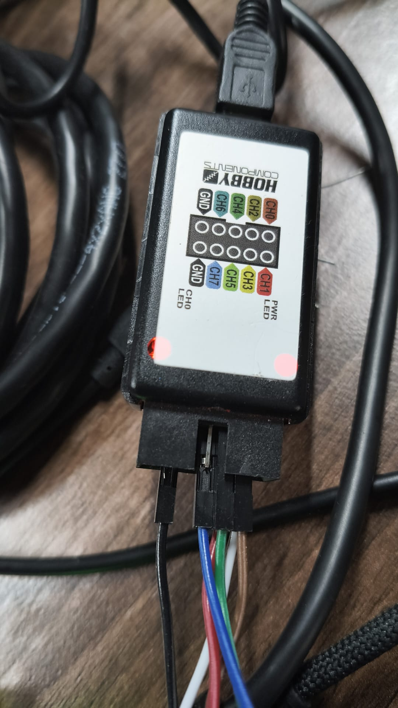
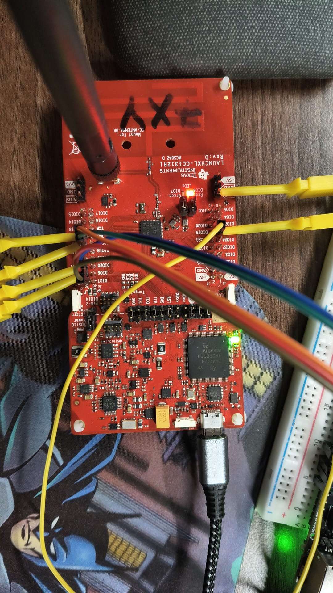
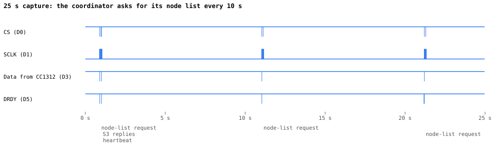
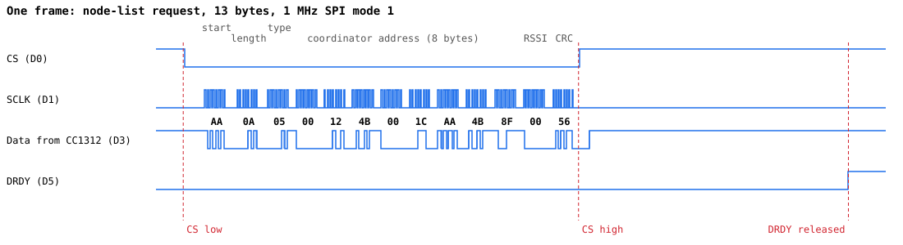

This page records how a cheap USB logic analyser was used to bring up the SPI link
between a CC1312R LaunchPad (running the coordinator firmware) and the ESP32-S3
(`esp32s3-poe-eth`). It is written for someone who has not used a logic analyser
before.

## What a logic analyser does

A logic analyser is an 8-channel digital voltmeter that records very fast. Each
channel samples its wire millions of times a second and stores only "high" (above
about 1.5 V) or "low". Plot the samples against time and you see exactly what each
signal did: when CS went low, how many clock pulses there were, which bits were on
the data line. Software can then decode the bits into bytes.

Unlike the S3's serial log, it shows what is really on the wire, not what the
firmware believes it sent or received. When the two disagree, the fault is in
between: a wire, a joint, a pin.

## Equipment

- **Analyser:** Hobby Components 8-channel USB logic analyser. It is a clone of the
  original Saleae Logic, built on a Cypress FX2 chip (USB ID `1d50:608c` once its firmware
  is loaded), good to about 24 MHz sample rate.
- **Software:** [sigrok](https://sigrok.org) command line tools, on Manjaro:

  ```sh
  sudo pacman -S sigrok-cli sigrok-firmware-fx2lafw
  ```

  Unplug and replug the analyser after installing the firmware package.
  `sigrok-cli --scan` should then list an `fx2lafw` device.

The analyser's connector has two rows: CH0, CH2, CH4, CH6, GND on top and CH1, CH3,
CH5, CH7, GND underneath. sigrok calls the channels D0 to D7.



## Connections

The S3 was wired to the LaunchPad's underside header sockets, which leaves the top
pins free for the analyser's hook clips (the clips grip under the dupont housings,
on the bare pins).



| Analyser | Signal | LaunchPad pin | S3 GPIO |
|---|---|---|---|
| D0 | CS | DIO8 | 18 |
| D1 | SCLK | DIO10 | 15 |
| D3 | Data from the CC1312 (CC1312 POCI, S3 MISO) | DIO9 | 17 |
| D5 | DRDY | DIO12 | 38 |
| GND | Ground | GND | GND |

The analyser's ground must be connected, or the readings are meaningless.
An unconnected channel floats and reads as a constant 1. The S3 → CC1312 data line
(MOSI, DIO11) had no probe in these captures.

## Capturing

```sh
# 25 s at 4 MHz on all 8 channels: 4 samples per bit of the 1 MHz SPI clock
sigrok-cli -d fx2lafw --config samplerate=4m --time 25s -o capture.sr

# Decode SPI (mode 1: CPOL 0, CPHA 1) and print each byte with its sample number
sigrok-cli -i capture.sr -P spi:clk=D1:miso=D3:cs=D0:cpol=0:cpha=1 \
  -A spi=miso-data --protocol-decoder-samplenum
```

The `.sr` file opens in PulseView (sigrok's GUI) if you want to scroll and zoom.

Sample rate matters. Sample at least 4 times faster than the fastest signal; at
4 MHz a 1 MHz clock gives 4 samples per bit. Higher rates fill memory faster and
the cheap analysers drop samples over USB when pushed.

## What a working link looks like

### Over 25 seconds



Activity comes in bursts about 10 s apart. That matches the coordinator firmware:
while the S3 has sent it no nodes, it asks for the node list every 10 s
(`NODE_LIST_EMPTY_RETRY_RAT`), backing off to every 300 s once it has nodes. The
first burst also contains a heartbeat (sent every 30 s), and the S3's reply:
CS and SCLK activity with D3 idle, because the S3's data goes the other way, on
MOSI.

### One frame



This is the node-list request, zoomed in so that the whole frame spans the
picture (about 250 µs). Reading left to right:

1. **DRDY is already low.** The coordinator pulled it low about 3.4 ms earlier
   (off the left edge) to say "I have a frame ready". The 3.4 ms is the S3 noticing
   on its next pass through `loop()`.
2. **CS low:** the S3 selects the coordinator.
3. **SCLK bursts:** the S3 clocks 13 bytes, 8 pulses each. The gaps between bursts
   are the S3's software between `SPI.transfer()` calls.
4. **Data:** the coordinator puts each bit on D3. The decoder turns them into
   `AA 0A 05 00 12 4B 00 1C AA 4B 8F 00 56`:

   | Bytes | Meaning |
   |---|---|
   | `AA` | Start byte |
   | `0A` | Length: 10 bytes follow, before the CRC |
   | `05` | Message type: node-list request |
   | `00 12 4B 00 1C AA 4B 8F` | Coordinator address (its IEEE address, big-endian) |
   | `00` | RSSI (0: not a radio packet) |
   | `56` | CRC |

5. **CS high:** the S3 is done (145 µs after CS went low).
6. **DRDY released:** about 100 µs later the coordinator raises DRDY, ready for the
   next frame.

The S3's serial log for the same frame shows the same bytes:

```text
DEBUG: [CC1312] RAW(13): AA 0A 05 00 12 4B 00 1C AA 4B 8F 00 56
INFO : [CC1312] Node list requested — response deferred 80 ms (0 entries)
```

## What the fault looked like

Before the link worked, the S3 logged nothing from the coordinator. The coordinator
was clearly running (its red LED flashed on radio packets), so the question was
which side was wrong.

A 10 s capture showed:

- **D5 (DRDY): low for the whole capture.** The coordinator had a frame ready and
  was waiting.
- **D0 (CS) and D1 (SCLK): no edges at all.** The S3 never tried to read it.

So the coordinator was doing its job and the S3 was not responding to DRDY. The S3
firmware's view disagreed with the wire: its GPIO input register showed GPIO38
reading **high** while the analyser, clipped on the same wire, saw it **low**.
When the wire and the chip disagree, the fault is between them. Here it was the
DRDY wire plugged into IO39, one pin over from IO38. With nothing driving it,
GPIO38's pull-up held it high.

Two firmware changes came out of this:

- The S3's 35 s "No data" warning now prints DRDY's current level and the actual
  pin numbers, so this fault shows up in the log.
- `CC1312Manager::update()` reads again if DRDY is still low 1 s after a read, so a
  missed or failed read cannot leave the link stuck.

## Quick checks without decoding

Most faults show without decoding any bytes. Count edges per channel:

| What you see | What it means |
|---|---|
| DRDY never goes low | Coordinator not running, not powered (3V3 jumper), or DRDY not wired to DIO12 |
| DRDY low and stays low, no CS/SCLK | The S3 isn't seeing DRDY: wrong pin, bad joint, or the S3 isn't running the CC1312 code |
| CS and SCLK toggle but data stays at 1 | The data line isn't connected, or the coordinator's SPI isn't primed |
| Decoded bytes don't start with `AA` | Wrong SPI mode, or the data probe is on MOSI instead of MISO |
| Every channel constant 1 | Probes not touching the pins, or ground not connected |
